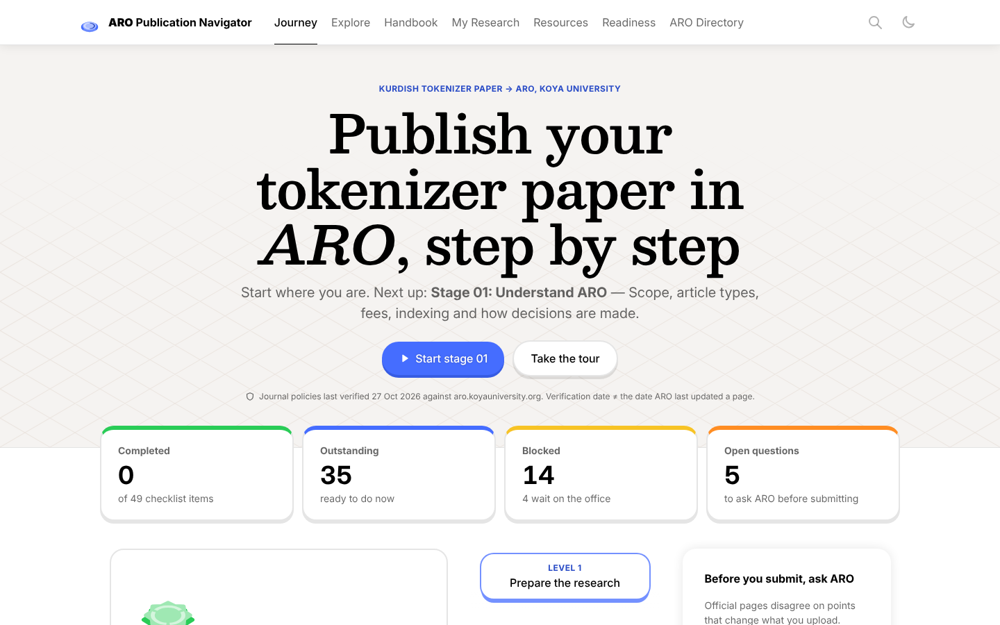

# ARO Publication Navigator

An interactive, source-linked companion for publishing **Kurdish tokenizer research** in **[ARO – The Scientific Journal of Koya University](https://aro.koyauniversity.org/)**. It walks a manuscript from "does this fit ARO?" to "the DOI is on my ORCID", and keeps every claim tied to the official page it comes from.

> Independent study aid. Not an ARO or Koya University service. Official rules live at aro.koyauniversity.org. Journal policies last verified **27 October 2026**.



## What's inside

| Area | What it does |
|---|---|
| **Journey** | Ten stages on a Brilliant-style course path (3D lesson plates with split progress rings). Each stage has lessons, exact actions, the ARO rules that apply, documents, sources, a completion checklist and the next recommended action. Nothing is locked: unmet prerequisites show a warning. Progress dashboard and "Continue where I left off". |
| **Explore** | The publication knowledge graph: 139 nodes (stages, requirements, open questions, official pages, documents, tools, manuscript sections, editorial processes, submission artifacts) and 368 typed edges (*requires, depends on, explained by, downloaded from, submitted during, reviewed under, leads to, conflicts with*). Pan, zoom, fit, search, filter by node type and relation, "Path from Stage 01" (shortest path), "Everything it needs" (transitive dependencies), and an accessible list view (default on phones). Built from the same data as the journey, so stage nodes show live progress. |
| **Handbook** | 53 ARO requirements in 21 chapters, each paraphrased, explained, with how to comply, status (mandatory / conditional / recommended / informational), sources and dependent stages. Interactive modules: section ordering, length-vs-figures calculator, abstract workbench, equations explorable, figure dpi calculator, a 10-part **Harvard referencing module** with practice questions, AI-policy scenarios, an anonymisation exercise, a submission walkthrough and a review simulator with a response-to-reviewers template. |
| **Open questions** | 12 places where ARO's own pages disagree, shown side by side with analysis and a recommendation; unresolved ones can be marked answered once the office replies, which unblocks dependent checklist items. |
| **My Research** | Section-by-section guidance for the tokenizer paper (purpose → evidence → content → example → ARO rules → completion criteria), topics reviewers expect, and a research readiness matrix. Clearly marked as advice, not journal rules; no results are invented. |
| **Resources** | 26 verified documents, pages, portals and tools with format, purpose, source, status, stages and verification date; filters; "Download my preparation checklist". Templates link to ARO's own Google Docs/Drive files; nothing is re-hosted. Full source registry at `#/sources`. |
| **Readiness** | Every checklist item in one dashboard (done / to do / blocked / awaiting the office), an **in-browser .docx check** (word count, abstract, keywords, sections, length band, references, preprints, DOIs, font, spacing, page size, margins, figures, tables, template markers, identity signals), Markdown and print/PDF export, and progress backup/restore. Automated findings are advisory and kept separate from self-declared ticks. |
| **ARO Directory** | Journal identity, searchable directory of 28 editors, advisory board and office staff (decision-makers vs administration), contacts, and a pre-filled email of the open questions (opens your mail app; nothing is sent by the site). |

Every piece of guidance is labelled **Official ARO requirement**, **General academic recommendation** or **Project-specific recommendation**.

## Key findings from the research

- **Anonymisation conflict (unresolved).** The Guide to Authors and the Stage-One template put all author details on page 1 and say the office removes them; submission checklist item 7 says submit without author names. The site keeps both sources and recommends asking the office and preparing both files.
- **AI policy.** AI-generated text is banned as scientific misconduct, while the same page recommends grammar checkers and lists "free AI writing tools". Treated as: write everything yourself; grammar correction only; ask about the rest.
- **No non-peer-reviewed preprints** may be cited; at least **15 references**; similarity above **15%** is declined; word count and figure count trade off (e.g. 5,000–6,000 words allows fewer than 8 figures); at most 12 tables.
- **No discipline box for NLP** on the template; the site suggests asking which to tick.

Details, every source and every contradiction: [RESEARCH_AUDIT.md](RESEARCH_AUDIT.md).

## Run it locally

Requirements: Node.js 18+ and TypeScript (`npm i -g typescript`). There are **no runtime dependencies** and no bundler: the build validates the data, generates a typed data module, compiles TypeScript to ES modules and copies the design system.

```bash
git clone https://github.com/SawabS/ARO-Publishing-Guide.git
cd ARO-Publishing-Guide
npm run build          # validate data → src/generated/data.ts → tsc → dist/
npm run serve          # http://localhost:4173  (any static server works)
```

Progress is stored in the browser's localStorage only; manuscripts checked on the Readiness page are read in the browser and never uploaded.

## Test

```bash
pip install playwright python-docx && python -m playwright install chromium
npm run serve &                     # in another terminal
npm run test:e2e                    # 28 end-to-end checks
npm run screenshots                 # light/dark × desktop/mobile into qa/screenshots, plus overflow and console checks
npm run validate:data               # data integrity only
npm run check:links                 # re-check every source URL → link-report.json
```

The end-to-end suite covers every route, progress persistence and cross-view sync, blocking and unblocking, search, graph selection/paths/list view, every interactive module, the .docx checker against generated compliant and non-compliant manuscripts (plus a corrupt file), exports, directory search and the mailto draft, the guided tour, keyboard use, theme persistence, reset, and a 320px dark reduced-motion pass with no horizontal overflow.

## Deploy

`.github/workflows/pages.yml` builds, runs the end-to-end tests and deploys `dist/` to GitHub Pages on every push to `main`, and runs the link checker as a non-blocking job. One-time setup: **Settings → Pages → Build and deployment → Source: GitHub Actions**. Any static host works too: upload `dist/`.

## Project structure

```
data/                 structured content: the single source of truth
  sources.json        source registry (48 sources, verification status and date)
  requirements.json   53 ARO requirements → sources, stages, chapter, conflicts
  conflicts.json      12 places where official sources disagree
  stages.json         10 publication stages: lessons, actions, checklist (with dependencies)
  resources.json      26 documents, pages, portals and tools
  people.json         journal facts and the editorial directory (no personal emails)
  research.json       tokenizer-paper sections, topics and readiness matrix
  graph.json          extra graph nodes (processes, artifacts) and edges
  handbook.json       handbook chapters and their interactive modules
scripts/              build, data validation, link checker
src/
  main.ts             app shell, hash router, search, tour, theme
  lib/                model (indexes, progress, graph algorithms), store, DOM helpers, UI parts, quiz, .docx reader
  views/              journey, explore, handbook, research, resources, readiness, directory
  styles/app.css      app layer on top of the design system
vendor/brilliant/     Brilliant Web Skill tokens, fonts, CSS, JS and icons (unchanged)
tests/                e2e.py, shoot.py
qa/screenshots/       visual QA evidence
RESEARCH_AUDIT.md     pages inspected, facts, downloads tested, contradictions, open questions
```

Entities follow the brief: `PublicationStage`, `Requirement`, `Source`, `Resource`, `ResearchSection`, `GraphNode`, `GraphEdge`, `ProgressRecord` (see `src/types.ts`). The journey, graph, handbook, readiness dashboard and search all read the same indexes in `src/lib/model.ts`, so they always agree.

## Design system

Built on [Brilliant Web Skill](https://github.com/SawabS/brilliant-web-skill), vendored unchanged under `vendor/brilliant/`: its tokens and roles, bundled OFL fonts, 3D lip buttons, lesson-node plates rendered by `B.node()`, course map, segmented controls, lip tiles, callouts, tables, motion and synthesized sounds. The app adds only layout and the components the skill doesn't have (graph, dashboards, modules) in `src/styles/app.css`, using the skill's semantic roles. Light and dark themes, `prefers-reduced-motion`, visible focus rings, keyboard operation and 320px layouts are supported.

## Updating the content

Edit the JSON in `data/`, bump `verified` dates in `sources.json`, and rebuild. The build refuses data where a requirement lacks an official ARO source or any reference doesn't resolve. Add new contradictions to `conflicts.json` rather than silently picking a side.
